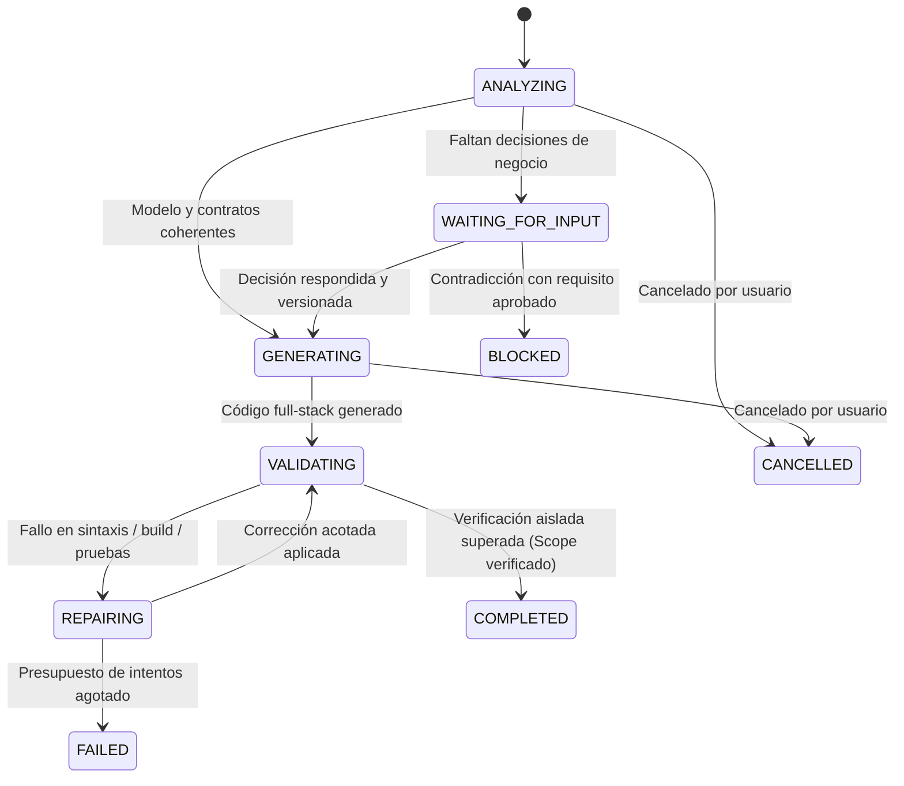

# Revisión del generador y aceptación de Autron5 — 2026-10-31

**Estado global: `ready=false`.** El flujo de alta **Cliente → Vehículo → Recepción** del rol **Recepción** pasó pruebas de API, persistencia y navegador con PostgreSQL real. Esto no certifica todo AUTRON ni todas las acciones de RF-03/RF-04.

## Fuentes y decisiones

Proyecto: `Autron5`, `6ba45264-e3e6-4819-a0dd-18909f1fb674`.

Se revisaron el documento `AUTRON_Propuesta_Overleaf.pdf` (SourceVersion `bab6474a-2ca7-4f65-bbff-b1bd0d3385c7`), los requisitos aprobados, actores, casos de uso, E/R, clases, flujo, navegación, versiones de mockups y el snapshot aprobado v8.

- RF-03 fundamenta el registro de clientes; RF-04 y las reglas del documento exigen asociar cada vehículo a un cliente responsable.
- RF-07 fundamenta la recepción y sus datos. El E/R existente ya relaciona VEHICULO → RECEPCION → EVIDENCIA_MULTIMEDIA, con USUARIO como responsable.
- El perfil Recepción registra ingresos y mantiene datos operativos. Ya estaba vinculado a UC-16, UC-20 y UC-24; no se incorporaron actores adicionales.
- RF-17 exige crear órdenes a partir de ítems autorizados. El antiguo botón «Confirmar y Crear Orden de Servicio» no estaba sustentado para esta recepción y fue sustituido por «Confirmar recepción».
- No se convirtieron nombres de métodos de clases ni textos narrativos en permisos o procesos automáticos.

Decisiones confirmadas expresamente por el usuario en esta conversación:

| Punto | Regla implementada |
|---|---|
| Identificación | Nombre del cliente y placa obligatorios; VIN opcional. No se añadió unicidad de placa/VIN. |
| Recepción | Vehículo, kilometraje, combustible y motivo obligatorios. Observaciones y fotos opcionales. |
| Kilometraje | Guardar la lectura exclusivamente en RECEPCION, sin comparar ni actualizar kilometraje_actual. |
| Combustible | Fracción entre 0 y 1; interfaz con vacío, 1/4, 1/2, 3/4 y lleno. El valor cero es válido. |
| Fotografías seleccionadas | Terminar correctamente todas las cargas antes de ejecutar la operación de recepción. Un fallo conserva el formulario y no confirma el ingreso. |

No quedan preguntas de negocio pendientes para este flujo de alta. Las decisiones se conservaron en el manifiesto versionado y en `decisionEvidence` de los contratos ejecutables.

## Cambios en el proyecto

[Manifiesto de Autron5](backend/specifications/autron5/intake.contract.json) y [aplicación reproducible del contrato](backend/scripts/prepare-autron5-intake.cjs).

- UC-20: alta de CLIENTE con proyección explícita de campos. No crea automáticamente una cuenta de usuario.
- UC-24: comprobar que existe el cliente responsable y crear VEHICULO con esa relación.
- UC-16: comprobar vehículo; si se selecciona una cita, comprobar que corresponde a ese vehículo; crear RECEPCION con usuario autenticado y fecha del servidor; crear las evidencias seleccionadas con la PK de esa recepción. La respuesta identifica la recepción creada.
- Los registros de RECEPCION y EVIDENCIA_MULTIMEDIA se guardan en una transacción. Un error durante la inserción de una evidencia revierte la recepción.
- Se vincularon las tres pantallas existentes con requisitos, actores, operaciones, fuentes y campos. Las fuentes son registros reales; los selectores conservan IDs internos y muestran nombres/placas.
- Se añadieron versiones corregidas de los tres mockups, conservando versiones anteriores y su procedencia. Los borradores siguen en `PENDING_REVIEW`.
- Las PK, el usuario responsable y las fechas no se piden en el formulario. La API rechaza intentos de enviarlos mediante parámetros adicionales.
- La interfaz permite seleccionar archivos, confirmar, consultar la recepción persistida y abrir sus fotografías con autenticación. En móvil, las tablas se presentan como tarjetas y el menú se abre/cierra realmente.

El alcance comprobado de UC-20/UC-24 es el **alta**. No se declara terminada la actualización de clientes prevista también por RF-03 ni los portales de otros actores.

La comprobación de integridad confirmó que **todos los requisitos permanecen idénticos** y que el **snapshot aprobado v8 no fue alterado**. Ese snapshot quedó desactualizado respecto a los contratos nuevos; no se creó ni aprobó un reemplazo automáticamente.

## Correcciones genéricas

| Tramo | Implementación |
|---|---|
| Requisitos → UC → operaciones | Pasos y referencias declarativos; se conservan parámetros, colecciones, filtros, resultados previos y procedencia. Sin deducir escrituras por títulos. |
| Contrato → backend | Runtime de referencias tipadas, validación de cuerpos, transacciones y permisos del contrato. Las referencias no se evalúan como JavaScript. |
| Contrato → formularios/mockups | Campos automáticos, editables y relaciones comunes; tareas con fuentes y controles explícitos, sin identidades ni valores precargados ficticios. |
| Código → navegación | Tareas ordenadas por contrato y autorizadas por sesión, sin deducciones de roles por palabras del título ni pestaña inicial no autorizada. |
| Mockups → compilación | El conversor procesa correctamente atributos JSX con flechas `=>` y objetos; conserva todos los mockups en el paquete. |
| Seguridad | No hay alias GET para operaciones que escriben. CRUD sin permiso explícito y operaciones autenticadas sin roles se rechazan. Las respuestas CRUD excluyen hashes y secretos de asociaciones. |
| Archivos | Cargas privadas y autenticadas, token de carga ligado al usuario, tipo de imagen comprobado y rutas de consulta autenticadas. |

Las reglas de AUTRON están en su manifiesto y en la evidencia del proyecto, no en estos motores genéricos.

## Exportación y bloqueos

Se generó un **paquete de revisión** con 202 archivos de aplicación y evidencia adjunta. Incluye las 18 pantallas; no se eliminaron los otros mockups para conseguir la compilación.

- [ZIP de revisión](.verification/autron5-review-SKWBds.zip)
- [Resultado de aceptación](.verification/autron5-review-SKWBds/acceptance-results.json)
- [Integridad y bloqueos](.verification/autron5-review-SKWBds/source-integrity.json)
- [Captura de recepción en escritorio](.verification/autron5-review-SKWBds/desktop-recepcion.png)
- [Captura de recepción en móvil](.verification/autron5-review-SKWBds/mobile-recepcion.png)

El ZIP muestra `ready=false` en README, interfaz y `REVIEW_STATUS.json`. La exportación normal sigue bloqueada; `reviewOnly` no convierte los diagnósticos en aprobaciones ni permite el ZIP normal. Las operaciones de negocio no implementadas del paquete de revisión responden `501 UNRESOLVED_OPERATION`, sin ejecutar una escritura de sustitución.

Quedan **157 diagnósticos globales**:

| Código | Cantidad | Trabajo pendiente |
|---|---:|---|
| UNRESOLVED_OPERATION_PERMISSION | 115 | Permisos CRUD no declarados en el resto del modelo. No se asume que aprobar un actor autoriza todos los CRUD. Debe completarse la matriz desde requisitos/actores; entretanto se rechazan. |
| UNDEFINED_OPERATION_BEHAVIOR | 27 | Otros casos de uso todavía narrativos, sin operaciones ejecutables verificables. |
| UNRESOLVED_SCREEN_CONTRACT | 15 | Pantallas ajenas al flujo de alta sin contratos completos. Incluye portales, diagnóstico, inventario y otros procesos. |

Además, esta aceptación no cubre actualización de clientes, provisión de cuentas de producción, rendimiento, optimización de fotografías de RNF-12 ni políticas de limpieza de cargas privadas que nunca se confirman. No se inventaron esas políticas. El bundle de revisión conserva todos los módulos y Vite advierte de su tamaño; no se certificó como distribución de producción.

## Pruebas

- `cd backend; npm run test:codegen`: **62 aprobadas (100%)**.
- Suites incluidas: `codegen_typeMapper`, `codegen_modelGenerator`, `codegen_specValidator`, `codegen_multi_domain`, `codegen_full_pipeline`, `codegen_snapshot_hash`, `codegen_dependency_freshness`, `codegen_real_business_operations`, `codegen_coverage_breakdown`, `codegen_auth_security`, `codegen_migrations_constraints`, `codegen_stitch_design_system`, `codegen_screen_contract`, `codegen_operation_runtime`, `codegen_decisions_service`, `codegen_persistent_job`, `codegen_ai_repair`, `codegen_generic_domain_acceptance`, `codegen_autron5_full_lifecycle`.
- Compilación Vite completa y comprobación sintáctica de todos los JS del backend exportado.
- Repetición de la aceptación con las dependencias instaladas en el propio backend/frontend exportado, sin resolver Sequelize, Express ni Vite desde iCASE. Se incluyen ambos `package-lock.json` en el ZIP.
- **29 migraciones reales**, incluidas claves foráneas, en PostgreSQL 16 temporal, puerto 55439, con una base nueva por ejecución. No se utilizó `sync` para reemplazar migraciones.
- Login real contra usuarios/roles de prueba aprovisionados en esa base, hashing y JWT. `401` sin token, `403` para Cliente/Mecánico/Administrador en UC-16, sin bypass de recepción por CRUD, sin escalada de rol por registro o modificación de USUARIO.
- Campos obligatorios y tipos; combustible cero y fuera de rango; cita de otro vehículo; usuario responsable falsificado rechazado.
- Cliente → vehículo → recepción persistidos; no se crea otro vehículo ni una orden y no cambia kilometraje_actual.
- Evidencia relacionada con la recepción y usuario; archivo no público; token inválido rechazado; rollback tras error de persistencia de evidencia.
- Consulta SQL desde una conexión independiente para confirmar relaciones persistidas.
- Chromium en **1440×900 y 390×844**: login, alta de cliente, selector por nombre, alta de vehículo, selección por placa, recepción, fallo de carga inducido sin petición de confirmación, reintento real, apertura de fotografía persistida y consulta tras recargar. Menú móvil y ausencia de desbordamiento horizontal comprobados.
- Inspección visual de las capturas de las tres pantallas. Los registros visibles etiquetados PRUEBA fueron persistidos por la prueba; no son datos ficticios incrustados en el mockup.

Los errores 400/403/415/422/501 que se provocan deliberadamente forman parte de las pruebas negativas. `passed=true` en el resultado de aceptación se limita al alcance descrito y coexiste con `ready=false` global.

`UNRESOLVED_DEPENDENCY_AUDIT`: la instalación informó 8 vulnerabilidades moderadas en backend y 1 moderada y 1 alta en frontend. Queda evaluar sus avisos, alcance y actualizaciones compatibles antes de una distribución de producción. No se aplicaron actualizaciones forzadas para ocultar estos resultados; este pendiente es adicional a los 157 diagnósticos del contrato.

## Pipeline Asistido por IA y Estados Persistentes (Generar Código)

La generación asistida por IA iniciada desde el botón **“Generar código”** en la interfaz de iCASE implementa una máquina de estados asíncrona y persistente con recuperación ante recargas:

### Componentes y Servicios

1. **`codegenJob.service.js`**: Gestor de trabajos asíncronos desacoplado de las peticiones HTTP. Permite polling (`/api/projects/:id/codegen/jobs/active`), cancelación (`/cancel`), persistencia en disco (`backend/.cache/codegen_jobs/<jobId>.json`), seguimiento de métricas y recuperación instantánea ante recarga del navegador.
2. **`codegenDecision.service.js`**: Detección de decisiones de negocio faltantes (p. ej. obligatoriedad de atributos, políticas de kilometraje/fotos). Presenta tarjetas interactivas con opciones recomendadas y campo de texto libre para respuestas personalizadas. Detecta contradicciones con requisitos aprobados, persiste revisiones versionadas en `.cache/codegen_decisions/<projectId>.json` y actualiza los contratos del proyecto en la base de datos sin duplicar preguntas activas.
3. **`codegenAiRepair.service.js`**: Análisis de coherencia contextual (requisitos, entidades, operaciones, pantallas). Propone correcciones dirigidas ante errores de validación con presupuesto estricto de tokens, tiempo e intentos (máx. 3 intentos). La aplicación de parches se encuentra estrictamente acotada al directorio de exportación, sin ejecución de comandos arbitrarios.
4. **`codegenVerification.service.js`**: Ejecutor de pruebas en entorno aislado con base temporal PostgreSQL en puerto 55439 (o 5433 fallback), ejecución de migraciones reales, verificación RBAC 401/403, transacciones, y recorridos visuales Playwright Chromium (1440x900 y 390x844).
5. **UI iCASE (`ProjectCodeGen.jsx`)**: Botón principal "Generar código" con insignia de IA, stepper visual por etapas, tarjetas de aclaración con opciones de radio y texto libre, consola de logs en tiempo real, métricas de consumo y visualizador de estado de aceptación.

### Demostración de Genericidad Multi-Dominio

El conjunto de pruebas automatizadas incluye `codegen_generic_domain_acceptance.test.js`, ejecutando la generación completa, verificación sintáctica, borrado absoluto del directorio exportado y regeneración determinista para el dominio **Biblioteca Digital** (Libros, Préstamos, Lectores), comprobando cero acoplamiento o palabras clave de Autron en el motor genérico.

## Reproducir

1. Configurar `DATABASE_URL` de iCASE y ejecutar `node backend/scripts/prepare-autron5-intake.cjs` para inspeccionar/preparar. `--apply` aplica el contrato solo a Autron5 mediante transacción y conserva la narrativa previa.
2. Ejecutar `node backend/scripts/export-autron5-review.cjs`. La ubicación queda en `.verification/autron5-last-export.json`.
3. Instalar dependencias en los directorios backend/frontend de esa exportación. Instalar Chromium para Playwright y configurar `PLAYWRIGHT_BROWSERS_PATH` si se usa una carpeta local.
4. Preparar una instancia PostgreSQL de prueba independiente en `127.0.0.1:55439`, base inicial `autron5_acceptance`, usuario/contraseña de prueba `icase_user`/`icase_password`. No apuntar la prueba a la base iCASE de 5433.
5. Ejecutar `cd backend; npm run test:autron5`. Crea una base con nombre aleatorio en esa instancia, usa el código exportado y guarda resultados/capturas junto al paquete.

Los datos y cuentas de prueba se aprovisionan únicamente en la base temporal. No se entregan credenciales de producción ni se amplían permisos para superar las pruebas.
