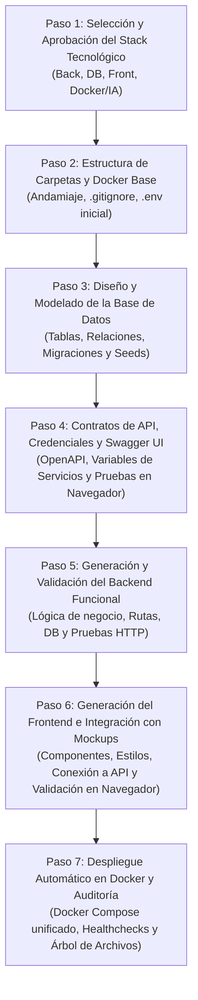

# Metodología y Plan de Desarrollo Paso a Paso para la Generación de Software Asistida por IA

Esta guía documenta la metodología formal, secuencial e iterativa para construir una aplicación web 100% funcional. El proceso está diseñado para garantizar control total por parte del usuario, validaciones en cada etapa, prevención de errores en cascada y optimización en el consumo de tokens.

---

## 🧭 Principios Fundamentales del Proceso

1. **Aprobación Obligatoria en Cada Fase:** La IA no pasa a una fase subsiguiente sin el visto bueno explícito del usuario (*Aprobar*, *Modificar* o *Consultar alternativas*).
2. **Desacoplamiento mediante Contratos:** El Backend y el Frontend se construyen sobre una especificación estricta de API probada previamente en Swagger UI.
3. **Persistencia Real:** No se emplean datos ficticios en memoria en las fases finales; cada formulario e interfaz interactúa con la base de datos real.
4. **Reproducibilidad en Docker:** La arquitectura completa (Base de Datos, Backend, Frontend y servicios auxiliares) se orquesta en contenedores listos para ejecutarse con un solo comando.
5. **Preparación para Evaluaciones Académicas:** La estructura modular y el sistema de variables centralizadas permiten aplicar cambios solicitados por un docente en cuestión de segundos.



---

## 📋 Detalle de Fases de Implementación

### Paso 1: Selección y Aprobación del Stack Tecnológico (Por Partes)
La IA no impone un stack rígido; evalúa el requerimiento del proyecto y somete a aprobación 4 componentes individuales:

1. **1.1 Backend:**
   * Selección de lenguaje y framework (ej. Node.js/Express, Python/FastAPI, NestJS).
   * Justificación técnica (rendimiento, facilidad de sustentación ante el docente, escalabilidad).
2. **1.2 Base de Datos:**
   * Motor relacional o documental (PostgreSQL, MySQL, MongoDB).
   * ORM / Herramienta de migración (Prisma, SQLAlchemy, TypeORM, Drizzle).
3. **1.3 Frontend & UI Kit:**
   * Framework de interfaz (React + Vite, Next.js, Vue).
   * Sistema de diseño y estilos (TailwindCSS, Shadcn/UI, Material UI).
4. **1.4 Docker & Servicios Auxiliares:**
   * Imágenes base optimizadas (Alpine/Slim).
   * Servicios de apoyo (Mailpit para pruebas de correo, pgvector para IA si aplica).

---

### Paso 2: Estructura de Carpetas y Configuración Docker Base
Establece los cimientos físicos del repositorio antes de redactar código de negocio.

* **Acciones de la IA:**
  * Generación del árbol de carpetas ordenado (`/backend`, `/frontend`, `/docker`, `/docs`).
  * Creación de archivos de control: `.gitignore`, `package.json` / `requirements.txt`, `docker-compose.yml` base.
  * Creación de los archivos de variables de entorno: `.env.example` y `.env` con credenciales de desarrollo por defecto para la base de datos local.
* **Tus Opciones en este Paso:**
  * Revisar la estructura y distribución de carpetas y dar tu visto bueno.

---

### Paso 3: Diseño y Modelado de la Base de Datos
Garantiza la fuente única de verdad para el almacenamiento de información.

* **Acciones de la IA:**
  * Diseño del esquema entidad-relación (tablas, campos, tipos de datos, llaves primarias/foráneas, restricciones e índices).
  * Creación del archivo de migración inicial.
  * Creación del script de semillas (*seeds*) con datos de prueba realistas para alimentar la base de datos desde el inicio.
  * Ejecución de la migración dentro del contenedor de BD para validar su integridad.
* **Tus Opciones en este Paso:**
  * Revisar las tablas y campos (ej. *"Agrégale un campo de teléfono a clientes"*).
  * Aprobar el esquema de datos una vez validado.

---

### Paso 4: Contratos de API, Credenciales y Pruebas en Swagger UI
Define el estándar de comunicación entre Backend y Frontend y centraliza las credenciales de servicios externos.

> [!IMPORTANT]
> **Aprobación Individual de Contratos:**
> Cada contrato (cada endpoint y su funcionalidad) se evalúa, se prueba en Swagger UI y se **aprueba de manera individual, uno por uno**. No se aprueban en bloque ni de forma masiva, garantizando control quirúrgico sobre cada endpoint antes de pasar al siguiente.

* **4.1 Definición y Aprobación Individual de Contratos (OpenAPI / Swagger):**
  * Para cada endpoint específico: Métodos (`GET`, `POST`, `PUT`, `DELETE`), parámetros de entrada, esquemas de validación de cuerpo (Body DTOs con Zod/Pydantic) y códigos de respuesta (`200 OK`, `201 Created`, `400 Bad Request`, `401 Unauthorized`, `500 Error`).
* **4.2 Gestión de Credenciales y Servicios Externos del Endpoint:**
  * Si el endpoint en evaluación requiere un servicio externo (ej. clave de correo SMTP, API Key de IA o pagos), en ese momento exacto se solicita y se registra en `.env`.
* **4.3 Pruebas Interactivas en Swagger UI (Endpoint por Endpoint):**
  * Se prueba el endpoint activo en Swagger UI con el botón **"Try it out"**.
  * Una vez que verificas su comportamiento y datos, otorgas tu **Aprobado Individual** para ese contrato antes de pasar a definir el siguiente.

---

### Paso 5: Generación y Validación del Backend Funcional
Construcción de la lógica del servidor basada estrictamente en los contratos aprobados.

* **Acciones de la IA:**
  * Programación de la arquitectura por capas: Controladores $\rightarrow$ Servicios (lógica de negocio) $\rightarrow$ Acceso a Datos / Modelos.
  * Middleware de autenticación (JWT), manejo global de errores y validaciones de entrada.
  * Ejecución de pruebas funcionales reales (consultas HTTP) para verificar que las rutas guardan y leen datos reales de la base de datos.
* **Tus Opciones en este Paso:**
  * Revisar los resultados de las pruebas funcionales del backend y otorgar aprobación para iniciar el Frontend.

---

### Paso 6: Generación del Frontend e Integración con Mockups
Construcción de la capa visual conectada al backend, respetando los diseños del usuario.

* **6.1 Recepción y Análisis de Mockups:**
  * La IA toma tus imágenes, exportaciones de Figma o wireframes como referencia de diseño.
  * Extracción de paleta de colores, tipografías y descomposición en componentes reutilizables (Navbar, Sidebar, Modales, Tablas, Tarjetas).
* **6.2 Conexión con los Contratos de API:**
  * Los formularios y tablas se enlazan directamente a las rutas del Backend probado en el Paso 5.
* **6.3 Validación por parte del Usuario (en el Navegador):**
  * Accedes a `http://localhost:3000` (o `5173`).
  * **Prueba de Ciclo Completo:** Creas un registro en un formulario, observas la alerta de confirmación, recargas con `F5` y compruebas que la información sigue ahí porque persistió en la base de datos.
  * Inspeccionas la consola con `F12` para certificar cero errores de ejecución.
* **6.4 Soporte para Cambios en Vivo del Docente:**
  * Si el docente solicita cambios visuales (colores, textos, nuevos campos), gracias al *Hot Reload* se aplican en 15 a 30 segundos y se reflejan en pantalla de forma instantánea.

---

### Paso 7: Despliegue Automático en Docker y Auditoría de Archivos
Orquestación final de la solución completa para entrega o defensa.

* **Acciones de la IA:**
  * Generación de los `Dockerfile` optimizados para producción (multi-stage build).
  * Ensamblado del `docker-compose.yml` final que levanta Base de Datos, Backend y Frontend con el comando:
    ```bash
    docker compose up --build -d
    ```
  * Verificación de estados (*healthchecks*) de todos los contenedores en ejecución.
* **Auditoría Final:**
  * Presentación del árbol completo de archivos generados con un resumen explicativo de cada uno, para que el usuario conozca con precisión la estructura de su proyecto.

---

## 👥 Matriz de Roles y Responsabilidades

| Fase | Rol de la IA | Rol del Usuario | Entregable Validable |
| :--- | :--- | :--- | :--- |
| **P1: Stack** | Analiza requerimientos y propone tecnologías justificadas. | Revisa, pide ajustes o aprueba cada componente. | Ficha técnica aprobada. |
| **P2: Carpetas & Docker** | Genera estructura física, dependencias y `.env` base. | Audita la distribución de carpetas. | Árbol de archivos inicial y `.env`. |
| **P3: Base de Datos** | Modela tablas, relaciones, migraciones y datos semilla. | Revisa campos y entidades según negocio. | Esquema migrado y poblado en Docker. |
| **P4: Contratos & Swagger** | Redacta OpenAPI, configura credenciales en `.env` y monta Swagger UI. | Prueba endpoints con *"Try it out"* en Swagger y aprueba. | `openapi.yaml` y Swagger interactivo funcionando. |
| **P5: Backend** | Codifica la lógica, seguridad y acceso a BD; ejecuta pruebas HTTP. | Verifica que las respuestas del servidor sean exitosas. | Backend funcional respondiendo datos reales. |
| **P6: Frontend & Mockups** | Replica los mockups visuales y conecta las vistas con las APIs. | Prueba formularios en el navegador (`F5`), valida diseño. | Frontend interactivo y validado en navegador. |
| **P7: Despliegue** | Orquesta `docker-compose.yml`, ejecuta build y verifica salud. | Confirma que toda la aplicación levanta en un comando. | Aplicación completa en Docker + Árbol de archivos. |

