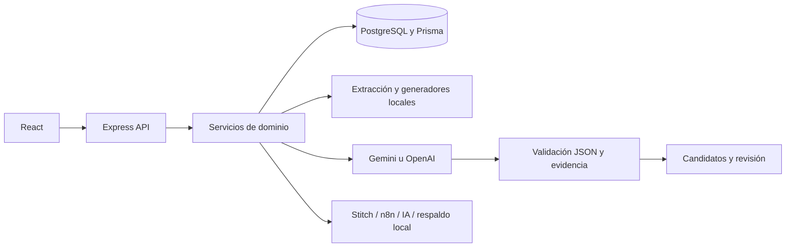

# ICASE — ingeniería de software trazable

ICASE es una herramienta CASE para convertir especificaciones PDF en requisitos y modelos trazables, revisarlos y mantener su historial. Combina extracción local, asistencia de IA, persistencia en PostgreSQL y visualización Mermaid en una aplicación React.

## Objetivo

Ayudar al equipo a pasar de evidencia documental a requisitos, modelos y prototipos revisables, conservando la relación entre fuentes, decisiones, versiones y cambios. Los resultados de IA necesitan validación: la herramienta no certifica cumplimiento ISO ni genera automáticamente una aplicación terminada.

## Funcionalidades principales

- Gestión de proyectos y fuentes PDF versionadas.
- Extracción local y análisis asistido por Gemini/OpenAI con evidencia y resultados parciales explícitos.
- Revisión, edición, aprobación y rechazo de candidatos RF/RNF y actores.
- Modelado de entidades, casos de uso, reglas, navegación, tecnologías y arquitectura.
- Diagramas Mermaid E/R, clases, casos de uso, procesos, navegación y arquitectura, según el flujo elegido.
- Prototipos de pantallas mediante Stitch, n8n, IA o respaldo local según configuración.
- Trazabilidad, análisis de impacto, control de cambios, historial y baselines.
- Consulta contextual local o asistida por proveedor; propuestas de cambio sujetas a revisión.
- Swagger/OpenAPI y portal técnico MkDocs Material en Docker Compose.

La carga de audio desde las rutas de fuentes está actualmente bloqueada por la política PDF, aunque existe un microservicio Whisper y adaptadores de audio en el repositorio. Ollama tiene un adaptador compatible y chat contextual, pero no implementa el contrato de extracción documental actual. No hay integración Anthropic Claude ni generador PlantUML.

## Fases y artefactos soportados

| Fase | Artefactos | Mecanismo |
| --- | --- | --- |
| Requisitos | RF, RNF, actores, evidencia y candidatos | Reglas locales y Gemini/OpenAI |
| Análisis | Relaciones, casos de uso, entidades y reglas de negocio | Servicios de dominio y revisión |
| Diseño | Mermaid, navegación, arquitectura y prototipos HTML/componentes | Generadores locales y proveedores según el flujo |
| Mantenimiento | Versiones, impacto, diferencias, baselines y exportación | Persistencia y servicios locales |

Consultar [ingeniería de prompts](docs/prompts.md) para las plantillas, entradas/salidas y modelos por fase. Los nombres de modelo son configurables; la versión realmente utilizada debe registrarse por ejecución.

## Requisitos previos y dependencias

Para Docker: Docker Engine/Desktop con Compose y acceso de red para descargar imágenes/dependencias. Configurar credenciales si se usarán servicios remotos. Ollama y Whisper pueden necesitar espacio y memoria adicionales para descargar modelos.

Para desarrollo local: Node.js 20 y npm, PostgreSQL 16; Python 3.9+ solo si se ejecuta MkDocs fuera de Docker. Las pruebas de navegador y las capturas requieren Edge o un canal Playwright compatible.

| Componente | Dependencias principales |
| --- | --- |
| Backend | Express, Prisma, Multer, pdf-parse y swagger-ui-express |
| Frontend | React, Vite, Mermaid, lucide-react |
| Documentación | MkDocs 1.6.1 y Material 9.6.23 |
| Audio local separado | FastAPI y faster-whisper |

Las dependencias completas están en los archivos `package.json`, `package-lock.json`, `requirements-docs.txt` y `whisper/requirements.txt`.

## Instalación y ejecución con Docker

Clonar el repositorio del equipo y abrir su directorio raíz. En PowerShell:

```powershell
Copy-Item .env.example .env
```

En Linux/macOS: `cp .env.example .env`. Completar la configuración antes del arranque:

```sh
docker compose up --build -d
```

Para iniciar la aplicación y documentación sin los servicios de modelos locales:

```sh
docker compose up --build -d postgres backend frontend mkdocs
```

| Servicio | Dirección |
| --- | --- |
| Aplicación | http://localhost:3001 |
| Salud HTTP | http://localhost:8080/api/health |
| Swagger del backend | http://localhost:8080/api/docs/ |
| Contrato OpenAPI | http://localhost:8080/api/openapi.json |
| MkDocs Material | http://localhost:8000 |
| PostgreSQL desde el equipo | localhost:5433 |

La comprobación de salud HTTP no verifica todos los proveedores. Entre contenedores PostgreSQL usa `postgres:5432`. El backend genera Prisma durante el build y arranca con `prisma db push --skip-generate`; revisar el esquema y respaldar datos antes de actualizar una instalación compartida.

Para iniciar solo la documentación: `docker compose up -d mkdocs`. Los cambios en `docs/` y `mkdocs.yml` se reflejan mediante los volúmenes montados.

## Configuración del entorno

| Variables | Propósito |
| --- | --- |
| `POSTGRES_USER`, `POSTGRES_PASSWORD`, `POSTGRES_DB`, `DATABASE_URL` | Persistencia y conexión local |
| `PORT`, `FRONTEND_URL`, `VITE_API_URL` | Direcciones del backend y cliente |
| `AI_PROVIDER`, `GEMINI_API_KEY`, `GEMINI_MODEL` | Proveedor documental por defecto y Gemini |
| `OPENAI_API_KEY`, `OPENAI_MODEL`, `OPENAI_REASONING_EFFORT` | OpenAI opcional |
| `OLLAMA_BASE_URL`, `OLLAMA_MODEL`, `OLLAMA_TIMEOUT` | Adaptador local compatible |
| `MOCKUP_PROVIDER`, `GOOGLE_STITCH_API_KEY`, `N8N_MOCKUP_WEBHOOK` | Prototipos de interfaz |
| `MAX_PDF_SIZE_MB`, `N8N_TIMEOUT`, `STITCH_CONCURRENCY` | Límites y tiempos de integración |

`.env.example` y Compose usan `gemini-3.1-flash-lite` para Gemini y `gpt-4o` para OpenAI; `config/env.js` tiene un valor por defecto distinto para OpenAI si no recibe configuración. Ver [integraciones](docs/integrations.md) para compatibilidad y valores efectivos. El nombre configurado no garantiza disponibilidad del modelo en la cuenta.

Las claves permanecen en el backend. No incorporarlas a `VITE_*`, commits, capturas o logs. `.env` está ignorado por Git. `MOCKUP_PROVIDER` y algunas variables usadas por Compose no están todas enumeradas en `.env.example`; revisar también `backend/src/config/env.js`.

La API no implementa autenticación ni autorización de usuarios actualmente. Restringir acceso y configurar TLS antes de exponerla. CORS no sustituye esos controles. Consultar [SECURITY.md](SECURITY.md).

## Desarrollo local

Configurar las variables en la terminal o en un archivo local `backend/.env` ignorado por Git. Al iniciar desde `backend`, un `.env` de la raíz no se carga automáticamente. `DATABASE_URL` debe apuntar a PostgreSQL disponible.

```sh
cd backend
npm ci
npm run prisma:generate
npm start
```

Si se usa una base nueva sin esquema, revisar y aplicar `npm run prisma:push` antes de iniciar. No ejecutar resets ni aceptar pérdida de datos en una base compartida.

En otra terminal:

```sh
cd frontend
npm ci
npm run dev
```

Para el portal local en un entorno Python:

```sh
python -m pip install -r requirements-docs.txt
python -m mkdocs serve
```

## Estructura del repositorio

```text
backend/
  prisma/             Esquema y migraciones
  src/
    routes/           Rutas HTTP
    controllers/      Adaptación de peticiones/respuestas
    services/         Análisis, IA, diagramas, ingeniería y mockups
    docs/             Contrato OpenAPI
  scripts/            Sincronización del portal técnico
  tests/              Pruebas y fixtures
frontend/
  src/                UI React y clientes HTTP
  scripts/            Capturas reproducibles
  tests/              Pruebas de interfaz
whisper/              Servicio local de transcripción
docs/                 Documentación técnica y recursos del portal
mkdocs.yml            Navegación de MkDocs Material
docker-compose.yml    Servicios del entorno
```

## Arquitectura y comunicación con IA



Este diagrama describe ICASE, no la arquitectura que debe asignarse a un proyecto analizado. El servicio de diagramas asistidos y la API de ingeniería utilizan tipos y ciclos de revisión distintos; consultar [referencia HTTP](docs/api-reference.md) y [prompts](docs/prompts.md).

## API, integraciones y prompts

- [Swagger integrado en MkDocs](docs/api-explorer.md) y [catálogo completo de endpoints](docs/api-catalog.md).
- [Referencia HTTP](docs/api-reference.md): métodos, parámetros, ejemplos, códigos, errores y formatos JSON/Mermaid/HTML.
- [Integraciones](docs/integrations.md): contratos externos, autenticación, secretos, cuota, timeouts y compatibilidad.
- [Ingeniería de prompts](docs/prompts.md) y [plantillas literales](docs/prompt-templates.md): artefactos por fase, entradas, salidas, modelos y control de versiones.
- [Guía de desarrollo](docs/developers.md), [modelo de datos](docs/data-model.md) y [operación](docs/operations.md).

## Capturas de funcionamiento

Capturas reales de la UI con respuestas sintéticas de API para no acceder a datos privados ni efectuar llamadas de IA. No certifican el flujo completo con proveedores externos. [Detalles y reproducción](docs/screenshots.md).


## Pruebas y verificación

```sh
cd backend
npm test
npm run docs:sync
npm run docs:check
cd ../frontend
npm run build
cd ..
docker compose run --rm mkdocs build --strict
```

`npm run docs:sync` actualiza la copia OpenAPI, los recursos locales Swagger y los catálogos de rutas/prompts del portal. Deben versionarse para que MkDocs funcione sin npm dentro del contenedor.

Pruebas adicionales: `npm run test:integration` en backend requiere PostgreSQL aislado; `npm run test:e2e` en frontend requiere API y navegador configurados. No usar una base de producción. Las suites offline no validan conexión, calidad ni coste real de proveedores. Ver [docs/testing.md](docs/testing.md).

## Contribuir y mantener

Leer [CONTRIBUTING.md](CONTRIBUTING.md) y [CODE_OF_CONDUCTS.md](CODE_OF_CONDUCTS.md). Documentar problema, solución y comprobaciones en cada solicitud de cambios. Actualizar `CHANGELOG.md`, el contrato OpenAPI y las páginas técnicas cuando corresponda.

Mantener respaldos, revisar auditorías y compatibilidad de dependencias, versionar prompts junto a su validación y comprobar impacto antes de modificar requisitos o esquemas. No compartir evidencia sensible en incidencias o logs. No hay un despliegue de producción ni conectividad externa certificados por esta documentación.

Licencia: [ISC](LICENSE.md). Reportes de vulnerabilidades: [SECURITY.md](SECURITY.md). Historial de cambios: [CHANGELOG.md](CHANGELOG.md).
