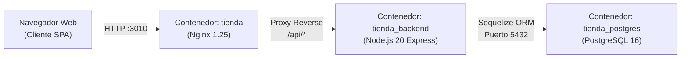
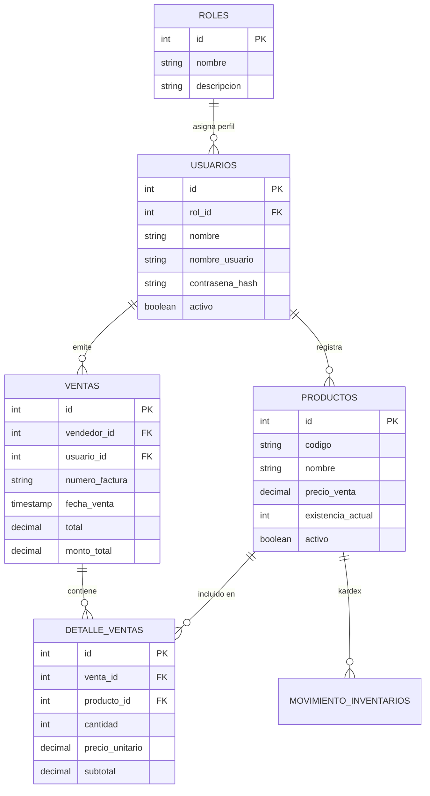

# Manual del Desarrollador — Tienda

Documentación técnica, arquitectura de software, especificación de API y guía de mantenimiento para **Tienda**.

---

## 1. Arquitectura General del Sistema

El sistema implementa una arquitectura cliente-servidor desacoplada basada en microservicios contenerizados:



### Componentes:
1. **Frontend (Contenedor `tienda`):**
   - Servidor Nginx sirviendo la SPA compilada con Vite.
   - Proxy reverso interno configurado en `/etc/nginx/conf.d/default.conf` que redirige `/api/` hacia el backend en el puerto 8080 interno de Docker.
2. **Backend (Contenedor `tienda_backend`):**
   - Servidor Express en puerto 8080.
   - Capa de autenticación con JSON Web Tokens (JWT) firmados con `HS256`.
   - ORM Sequelize para abstracción y persistencia relacional con PostgreSQL.
3. **Base de Datos (Contenedor `tienda_postgres`):**
   - PostgreSQL 16 con volumen persistente para datos transaccionales.

---

## 2. Modelo Relacional de Base de Datos (DER)



---

## 3. Catálogo de la API REST

Todos los endpoints (a excepción de login y healthcheck) requieren el encabezado:
`Authorization: Bearer <token_jwt>`

### 3.1. Autenticación (`/api/auth`)
- `POST /api/auth/login`
  - **Body:** `{ "identifier": "vendedor@nexora.ec", "password": "Password123!" }`
  - **Respuesta (200):** `{ "success": true, "token": "...", "user": { "id": 4, "role": "Vendedor" } }`
- `GET /api/auth/me`
  - **Respuesta (200):** Datos del usuario autenticado en sesión.

### 3.2. Productos e Inventario (`/api/productos`)
- `GET /api/productos`
  - Retorna el listado completo de productos activos con existencia y precio.
- `POST /api/productos` (Requiere rol: Administrador)
  - **Body:** `{ "codigo": "PROD-001", "nombre": "Arroz 1kg", "precio": 1.50, "stock": 50 }`
  - Normalización automática: El backend traduce `precio` a `precio_venta` y `stock` a `existencia_actual`.
- `PUT /api/productos/:id` (Requiere rol: Administrador)
  - Actualiza existencias o precio de un producto.

### 3.3. Ventas y Facturación (`/api/ventas`)
- `GET /api/ventas` (Roles: Administrador, Vendedor)
  - Retorna el histórico cronológico de comprobantes emitidos.
- `POST /api/ventas` (Roles: Administrador, Vendedor)
  - Emite factura con validación atómica y descuento de stock.
  - **Body de ejemplo:**
    ```json
    {
      "numeroFactura": "FAC-001-9482",
      "cliente": "Consumidor Final",
      "identificacion": "9999999999",
      "metodoPago": "Efectivo",
      "subtotal": 10.00,
      "iva": 1.50,
      "total": 11.50,
      "items": [
        { "productoId": 1, "cantidad": 2, "precio": 5.00 }
      ]
    }
    ```
  - **Respuesta (201):** Venta creada, stock actualizado y registro en kardex.
  - **Errores posibles:** `400 Bad Request` si el stock solicitado supera la existencia física.

### 3.4. Vendedores y Usuarios (`/api/vendedores` y `/api/usuarios`)
- `GET /api/vendedores`
  - Lista todas las cuentas con perfil de ventas.
- `POST /api/vendedores` o `POST /api/usuarios`
  - Registra un nuevo usuario con hashing seguro de contraseña mediante `bcryptjs` (salt rounds = 10).

---

## 4. Variables de Entorno y Configuración

El archivo `.env` del backend contiene las siguientes variables críticas:

```ini
PORT=8080
APP_NAME=Tienda
NODE_ENV=production
DB_HOST=db
DB_PORT=5432
DB_NAME=tienda_db
DB_USER=postgres
DB_PASSWORD=pg_secure_password
JWT_SECRET=super_secret_jwt_key_2026_icase
AUTO_SYNC_DB=false
```

---

## 5. Procedimientos de Mantenimiento y Depuración

### Ver logs en tiempo real
```bash
# Logs del backend Express
docker logs -f tienda_backend

# Logs del servidor web Nginx
docker logs -f tienda

# Logs de la base de datos PostgreSQL
docker logs -f tienda_postgres
```

### Ejecutar consultas directas en PostgreSQL
```bash
docker exec -it tienda_postgres psql -U postgres -d tienda_db -c "SELECT id, nombre_usuario, activo FROM usuarios;"
```

### Migraciones y Semillas
El contenedor backend ejecuta automáticamente `npm run migrate` y el script de demo users (`src/seed-demo-users.js`) en cada inicio para asegurar la integridad referencial.
