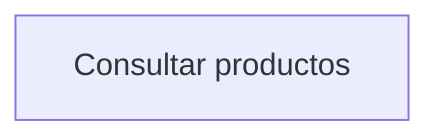

# Referencia HTTP del backend

Base local: `http://localhost:8080/api`. Los ejemplos usan datos sintéticos y marcadores `<projectId>`, `<sourceId>` y `<jobId>` que deben sustituirse por identificadores reales. En PowerShell usar `curl.exe` para evitar el alias de versiones antiguas; los bloques con `\` emplean sintaxis Bash.

Consultar todas las operaciones en el [catálogo de endpoints](api-catalog.md) y sus esquemas en el [explorador Swagger](api-explorer.md). La fuente OpenAPI está en `backend/src/docs/openapi.json`.

## Autenticación y formatos

Las rutas actuales de Express no implementan login, JWT ni autorización por proyecto. Por eso OpenAPI no exige un Bearer token ficticio. Las claves de proveedores son credenciales de salida del servidor y no autentican a los clientes de ICASE. Para exponer el sistema se requieren controles de acceso y TLS en la infraestructura o una implementación posterior de autenticación/autorización.

`Content-Type: application/json` para cuerpos estructurados y `multipart/form-data` para archivos; dejar que el cliente establezca el boundary al utilizar `-F`. Las respuestas habituales son `{success:true,data:...}`. Algunos controladores devuelven variantes; los ejemplos siguientes señalan esas diferencias.

## Proyectos

| Método | Ruta | Parámetros | Respuesta |
| --- | --- | --- | --- |
| GET | `/projects` | Query `includeArchived=true` opcional | 200, array en `data` |
| POST | `/projects` | `name` requerido; `description`, `systemDescription`, `status` opcionales | 201, proyecto en `data` |
| GET | `/projects/{id}` | ID de proyecto | 200 proyecto; 404 si no se encuentra/está archivado |
| PUT | `/projects/{id}` | Campos editables del proyecto | 200 proyecto actualizado |
| DELETE | `/projects/{id}` | ID | 200; archiva mediante el servicio de proyecto |
| POST | `/projects/{id}/restore` | ID | 200 proyecto restaurado |

```sh
curl -X POST http://localhost:8080/api/projects \
  -H 'Content-Type: application/json' \
  -d '{"name":"Catálogo de ejemplo","description":"Consulta de productos"}'
```

Respuesta reducida de ejemplo, HTTP 201:

```json
{"success":true,"data":{"id":"<projectId>","name":"Catálogo de ejemplo","description":"Consulta de productos","status":"PLANNING"}}
```

## Fuentes PDF y extracción

| Método | Ruta | Entrada | Salida |
| --- | --- | --- | --- |
| POST | `/documents/extract` | Multipart `file`, un PDF | 200, DTO de texto/secciones y extracción local sin IA |
| POST | `/documents/analyze` | Multipart `file` o JSON con `extractedText`/`extractionData`; proveedor/modelo opcionales | 200, análisis estructurado; no equivale por sí solo a aprobar requisitos |
| POST | `/projects/{projectId}/sources` | Multipart `files`, hasta 20 PDF | 201, fuentes/versiones y estado de extracción |
| GET | `/projects/{projectId}/sources` | ID de proyecto | 200, fuentes del proyecto |
| GET | `/sources/{sourceId}` | ID de fuente | 200 fuente o 404 |
| GET | `/sources/{sourceId}/versions/{version}` | Fuente y número de versión | 200 versión o 404 |
| POST | `/projects/{projectId}/files` | Multipart `files`, hasta 15 PDF | Resultado de carga del flujo compatible |

```sh
curl -X POST http://localhost:8080/api/projects/<projectId>/sources \
  -F 'files=@especificacion.pdf;type=application/pdf'
```

Para el endpoint sin persistencia de proyecto:

```sh
curl -X POST http://localhost:8080/api/documents/extract \
  -F 'file=@especificacion.pdf;type=application/pdf'
```

El límite de `/documents/*` y `/sources` es `MAX_PDF_SIZE_MB` por archivo, por defecto 10 MB; el flujo `/files` configura 35 MB por archivo. Se valida política PDF, y el procesamiento puede comprobar su firma. Los PDF sin texto útil pueden requerir una preparación externa: no se documenta un OCR general implementado.

## Análisis síncrono y trabajos asíncronos

`POST /sources/{sourceId}/analyze` acepta:

| Campo | Tipo | Requerido | Significado |
| --- | --- | --- | --- |
| `sourceVersionId` | string | No | Versión específica de la misma fuente; si se omite usa la vigente |
| `async` | boolean | No | `true` crea/recupera trabajo y responde 202 |
| `force` | boolean | No | `true` fuerza nuevo análisis en lugar de reutilizar el snapshot |
| `providerOverride` / `provider` | string | No | `gemini`, `openai`; `local` evita llamadas semánticas |
| `modelOverride` / `model` | string | No | Identificador de modelo solicitado al proveedor |

```sh
curl -X POST http://localhost:8080/api/sources/<sourceId>/analyze \
  -H 'Content-Type: application/json' \
  -d '{"async":true,"force":false,"providerOverride":"gemini"}'
```

HTTP 202:

```json
{"success":true,"data":{"jobId":"<jobId>","sourceId":"<sourceId>","status":"RUNNING"}}
```

```sh
curl http://localhost:8080/api/sources/<sourceId>/analysis/<jobId>
```

Ejemplo reducido al completarse, HTTP 200:

```json
{
  "success": true,
  "data": {
    "jobId": "<jobId>",
    "sourceId": "<sourceId>",
    "status": "COMPLETED",
    "result": {
      "success": true,
      "cached": false,
      "partial": false,
      "sourceId": "<sourceId>",
      "sourceVersionId": "<versionId>",
      "coverage": [],
      "failures": [],
      "metrics": {"provider":"gemini","model":"<modelo-efectivo>","requestsUsed":1},
      "requirementCandidates": [],
      "modelCandidates": []
    }
  }
}
```

El resultado completo incluye `extraction`, `summary`, `explicitRequirements` y otros campos del pipeline. `partial: true` indica extracción incompleta: revisar `failures` y `coverage`, incluso con HTTP 200. Un trabajo fallido tiene `status: "FAILED"` y `error`, también con HTTP 200 en la consulta. Los trabajos residen en memoria, se pierden al reiniciar y los finalizados se purgan al iniciar nuevos trabajos tras 30 minutos. Si se pierde un trabajo, comprobar datos persistidos antes de volver a facturar una llamada.

## Revisión y requisitos oficiales

| Método | Ruta | Entrada / comportamiento |
| --- | --- | --- |
| GET | `/projects/{projectId}/candidates` | Lista de candidatos; filtros según controlador |
| GET | `/projects/{projectId}/candidates/stats` | Estadísticas del centro de aprobación |
| GET / PUT | `/candidates/{candidateId}` | Consultar o editar el candidato |
| POST | `/candidates/{candidateId}/approve` | Aprobar candidato según sus validaciones |
| POST | `/candidates/{candidateId}/reject` | Rechazar candidato |
| GET / POST | `/projects/{projectId}/requirements` | Consultar o crear requisito |
| PUT / DELETE | `/requirements/{id}` | Editar o eliminar según el estado y control de cambios |
| PATCH | `/requirements/{id}/status` | Modificar estado; revisar impacto cuando corresponda |

No sustituir IDs persistidos por códigos visuales RF/RNF. Las operaciones de revisión pueden fallar si las evidencias o revisiones ya cambiaron. Las aprobaciones en lote y por categoría también están en el catálogo completo.

## Diagramas asistidos y validación

| Método | Ruta | Entrada | Respuesta |
| --- | --- | --- | --- |
| GET | `/projects/{projectId}/diagrams/availability` | Proyecto | Estado y datos faltantes por tipo |
| POST | `/projects/{projectId}/diagrams/generate` | `type` o `types`, `force` opcional | Diagrama o mapa de resultados por tipo |
| GET | `/projects/{projectId}/diagrams/{type}` | Tipo | Código almacenado, validación y disponibilidad |
| POST | `/projects/{projectId}/diagrams/{type}/validate` | `code`, `crossCompareCode` opcional | Validación sin guardar |
| PUT | `/projects/{projectId}/diagrams/{type}` | `code` requerido | Versión del código editado |
| POST | `/projects/{projectId}/diagrams/cross-validate` | `erCode`, `classCode` | Comparación semántica E/R–clases |

Tipos de este servicio: `ER`, `CLASS`, `USE_CASE`, `FLOWCHART`, `NAVIGATION`, `ARCHITECTURE`.

```sh
curl -X POST http://localhost:8080/api/projects/<projectId>/diagrams/generate \
  -H 'Content-Type: application/json' \
  -d '{"type":"FLOWCHART","force":false}'
```

Ejemplo reducido de respuesta; el proveedor real depende de configuración y fallback:

```json
{
  "success": true,
  "data": {
    "diagramType": "FLOWCHART",
    "mermaidCode": "flowchart TD\n  A[Consultar productos]",
    "code": "flowchart TD\n  A[Consultar productos]",
    "provider": "FALLBACK_DETERMINISTIC",
    "validation": {"isValid":true,"errors":[],"warnings":[]},
    "artifactVersionId": "<versionId>",
    "status": "GENERATED"
  }
}
```

En generación por `types`, cada resultado puede tener su propio `success:false` aunque el sobre HTTP sea 200. Datos insuficientes pueden devolver 422 con `{success:false,code:"INSUFFICIENT_DATA",error:"...",details:[...]}`. Una validación devuelve un reporte, no necesariamente un error HTTP si `isValid` es falso.

## Ingeniería, snapshots y cambios

Prefijo: `/projects/{projectId}/engineering`.

| Método | Ruta relativa | Entrada / salida principal |
| --- | --- | --- |
| GET | `/` o `/export` | Estado estructurado, requisitos, modelos, versiones, evidencia y matriz |
| POST | `/models/generate` | `requirementIds` opcional; crea candidatos desde requisitos aprobados |
| POST | `/models` | `kind`, `content`, referencias y evidencia de un candidato manual |
| PATCH | `/models/{id}` | `status` y/o `content`; revisión del candidato |
| POST | `/diagrams` | `type`, `artifactId` opcional; generador determinista del registro |
| PATCH | `/versions/{id}` | Revisión de versión; contrato según `DiagramService.review` |
| POST | `/versions/{id}/restore` | Nueva versión basada en una anterior |
| GET | `/impact/{type}/{id}` | Dependencias directas e indirectas |
| POST / PATCH | `/changes`, `/changes/{id}` | Proponer/revisar cambio; aprobación exige confirmación de impacto |
| POST / GET | `/baselines`, `/baselines/{id}` | Crear con `name` y consultar snapshot |
| POST | `/compare` | `before`, `after`, `type`: `Requirement`, `Artifact` o `Baseline` |
| PATCH | `/platform` | `platform`: `WEB`, `MOBILE`, `BOTH`, `UNKNOWN` |
| POST | `/sources/text` | `text` hasta 100000 caracteres, `type` `MANUAL`/`CHAT`, `name` opcional |
| POST | `/chat` | `message` hasta 4000 caracteres, `provider` opcional y `proposeChange` |

Tipos del registro de ingeniería: `ER_DIAGRAM`, `USE_CASE_DIAGRAM`, `NAVIGATION_DIAGRAM`, `FLOWCHART_DIAGRAM`, `SOFTWARE_ARCHITECTURE`, `SYSTEM_ARCHITECTURE`. No intercambiarlos con los nombres de la API de diagramas asistidos.

## Formato de artefactos

| Artefacto | Representación |
| --- | --- |
| Requisitos y modelos | Objetos JSON con IDs, campos de dominio, estados y evidencia/versiones |
| Diagramas | Cadena Mermaid en `mermaidCode`/`code` en el servicio asistido; contenido estructurado y renderizado en versiones de artefactos |
| Navegación de IA | JSON `nodes` normalizado y convertido a Mermaid |
| Mockups | `screens[]` con nombre/ruta, componentes y/o HTML; versiones con dependencias |
| Exportación de ingeniería | JSON por HTTP; la UI puede convertir información a Markdown |
| PlantUML | No existe un generador o endpoint PlantUML implementado |

Ejemplo Mermaid:



## Mockups y chat: ejemplos

```sh
curl -X POST http://localhost:8080/api/projects/<projectId>/mockup \
  -H 'Content-Type: application/json' \
  -d '{"prompt":"Usar formularios breves en español"}'
```

Requiere navegación y dependencias aprobadas, plataforma confirmada cuando corresponda y un proveedor configurado o respaldo disponible. La respuesta contiene pantallas y versiones; no debe confundirse con código de una aplicación terminada.

```sh
curl -X POST http://localhost:8080/api/projects/<projectId>/engineering/chat \
  -H 'Content-Type: application/json' \
  -d '{"message":"Consultar productos","provider":"local"}'
```

Respuesta ilustrativa:

```json
{"success":true,"data":{"answer":"No se encontraron requisitos aprobados relacionados. No hay evidencia suficiente para responder.","context":[]}}
```

## Códigos y manejo de errores

| Código | Uso y observaciones |
| --- | --- |
| 200 | Consulta/mutación completada; comprobar errores por elemento, `partial`, estado del trabajo o validación |
| 201 | Creación de proyecto/fuentes en los controladores que lo especifican |
| 202 | Trabajo asíncrono iniciado o activo para esa fuente |
| 400 | Parámetro obligatorio ausente, cuerpo inválido o fuente sin texto |
| 404 | Proyecto, fuente, versión, candidato, trabajo o ruta no disponible |
| 409 | Conflicto de pertenencia o versión/revisión en operaciones de dominio |
| 413 | Parser JSON demasiado grande; Whisper también lo usa para audio excesivo |
| 415 | Archivo/política no admitidos; rutas de audio bloqueadas por política PDF |
| 422 | Evidencia, precondiciones o diagrama inválidos; datos insuficientes |
| 429 | Algunos adaptadores propagan agotamiento de cuota; otros lo capturan como fallo parcial/fallback |
| 500 | Error sin clasificación HTTP explícita; incluye algunos errores de proveedores y Multer |
| 502 / 503 | Respuesta externa inválida o servicio no configurado/no disponible en caminos que lo clasifican |

El middleware central devuelve:

```json
{"success":false,"error":{"message":"Solo se permiten archivos PDF (.pdf).","code":"PDF_REQUIRED"}}
```

No todos los controladores usan este mismo sobre: generación de diagramas usa a veces `error` como cadena y `code` en la raíz. El 404 de rutas puede omitir `error.code`. El exceso de tamaño de Multer no está normalizado a 413 en el middleware actual, por lo que puede terminar como 500 con `LIMIT_FILE_SIZE`. Los clientes deben tolerar estas variantes y registrar errores sin secretos.

## Observaciones para clientes

No hay paginación ni límites globales homogéneos para todos los recursos. No reintentar automáticamente escrituras o generación con coste sin comprobar si el resultado ya fue persistido. Los trabajos asíncronos requieren afinidad al proceso o rediseño de cola compartida si se escala a varias instancias. Consultar [integraciones](integrations.md) para timeouts, cuotas, gestión de claves y diferencias entre proveedores.
