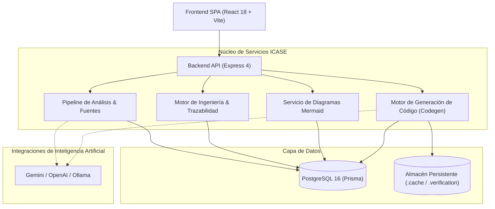

# Arquitectura

| Componente | Ubicación | Responsabilidad |
| --- | --- | --- |
| React y Vite | `frontend/` | Revisión de requisitos, matriz de trazabilidad, modelado, prototipos y banco de trabajo de generación de código |
| Express REST API | `backend/src/app.js` | Middleware centralizado, enrutamiento, validación y documentación OpenAPI/Swagger |
| Rutas y controladores | `backend/src/routes/`, `controllers/` | Endpoints modulares (`projects`, `engineering`, `codegen`, `requirements`, etc.) |
| Servicios de Análisis | `backend/src/services/analysis/` | Extracción documental, deduplicación léxica, detección de actores e inferencia de candidatos |
| Servicios de Diagramas | `backend/src/services/diagrams/` | Registro de generadores Mermaid (`DiagramRegistry`), validación sintáctica y normalización |
| Motor de Ingeniería | `backend/src/services/engineering/` | Gestión de workspace, snapshots de baseline, análisis de impacto y diffs de versiones |
| Motor de Generación de Código | `backend/src/services/codegen/` | Construcción de `projectSpec`, planificación de operaciones, jobs persistentes, verificación y empaquetado ZIP sellado |
| Prisma y PostgreSQL | `backend/prisma/schema.prisma` | Persistencia relacional, historial de revisiones, integridad referencial y auditoría |
| Transcripción | `whisper/` e integraciones | Procesamiento y transcripción de fuentes de audio mediante Whisper local |

## Subsistemas Principales

### 1. Interfaz de Usuario (Frontend)
La interfaz SPA consume los servicios REST a través de clientes HTTP tipados (`frontend/src/api/`). El estado del workspace se sincroniza reactivamente, permitiendo navegación modular entre Resumen, Fuentes, Requerimientos, Modelado (ER, Clases, Casos de Uso), Árbol de Navegación, Arquitectura, Prototipos/Mockups y Generación de Código.

### 2. Motor de Ingeniería y Trazabilidad (`engineering/`)
Los requisitos aprobados forman el núcleo del modelo. Cada elemento (entidad, caso de uso, nodo de navegación o componente) mantiene enlaces de dependencia (`ArtifactRelation`). El servicio `ImpactAnalysisService` recorre el grafo de dependencias de forma determinista para marcar automáticamente elementos afectados ante modificaciones, evitando bucles en estructuras cíclicas. Las líneas base (`ProjectBaseline`) almacenan copias snapshot inmutables para auditoría y comparación diferencial (`diff`).

### 3. Motor de Generación de Código y Verificación (`codegen/`)
El subsistema de codegen transforma la especificación formal del proyecto en código ejecutable de producción:
* **`projectSpecBuilder` y `projectSpecValidator`**: Consolida entidades, atributos, contratos y flujos de navegación en una especificación única (`projectSpec`), diagnosticando omisiones antes de iniciar la compilación.
* **Asistencia por IA**: `aiOperationPlanner` planifica pasos atómicos y validaciones de negocio; `aiMockupSynthesizer` mapea pantallas HTML y mockups a contratos REST.
* **Trabajos Persistentes (`codegenJobService`)**: Coordina la máquina de estados (`ANALYZING` → `WAITING_FOR_INPUT` → `GENERATING` → `VALIDATING` → `REPAIRING` → `COMPLETED`). El estado y métricas se persisten en disco (`.cache/codegen_jobs/`), permitiendo recuperación automática tras reinicios del servidor.
* **Verificación y Reparación**: `codegenVerificationService` compila y valida la sintaxis y migraciones; ante fallos sintácticos, `codegenAiRepairService` ejecuta ciclos de autocorrección controlada.
* **Integridad de Exportación**: `exportIntegrity` sella el paquete resultante generando un archivo `.zip` con verificación criptográfica SHA-256 en `.verification/`.

### 4. Capa de Datos y Persistencia
Prisma ORM gestiona el esquema PostgreSQL (expuesto en puerto local `5433` o `postgres:5432` en Docker). Los modelos garantizan consistencia transaccional y control de versiones optimista mediante campos de revisión numérica.

El punto de entrada del servidor es `backend/src/server.js`, mientras que `backend/src/app.js` desacopla la configuración Express para habilitar pruebas automatizadas unitarias, de integración y E2E sin arrancar listeners de red.
