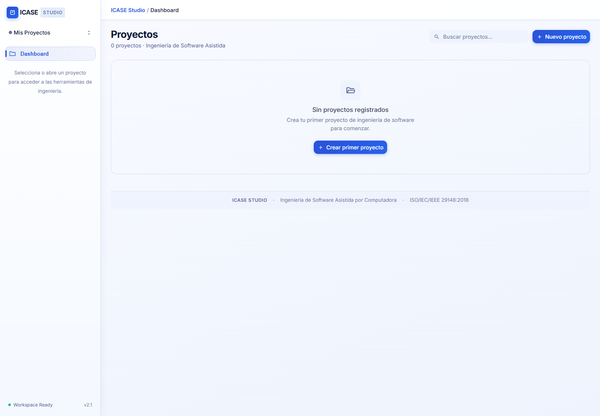
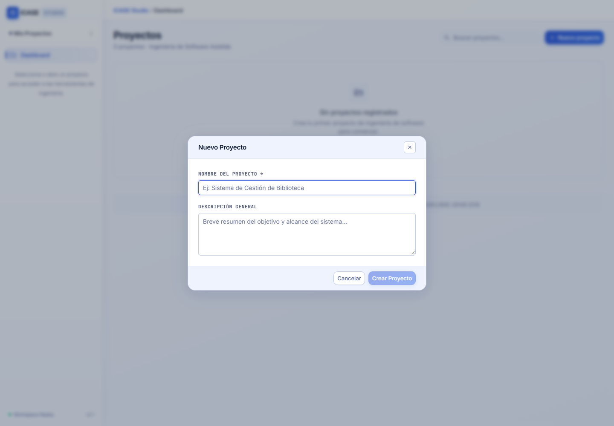
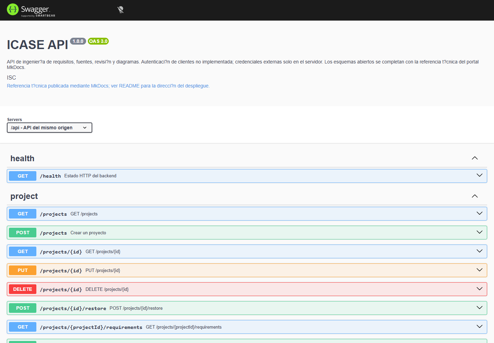

# Capturas de funcionamiento

Estas imágenes muestran la UI React y Swagger reales renderizados en un navegador. Para las vistas del frontend se intercepta la API con una lista vacía de proyectos: son capturas de demostración sin acceso a datos personales, sin escrituras en PostgreSQL y sin llamadas a modelos de IA. No prueban extracción, generación remota ni persistencia de extremo a extremo.

## Panel de proyectos



Permite localizar proyectos e iniciar la creación de uno nuevo.

## Creación de proyecto



El formulario solicita los datos iniciales del proyecto. La captura no envía el formulario ni crea registros.

## Swagger del backend



El servidor Express se inicia en un puerto temporal y sirve el contrato real. Esta captura no consulta la base de datos.

## Reproducir las capturas

En una terminal:

```sh
cd frontend
npm run dev -- --host 127.0.0.1 --port 4175
```

En otra terminal, desde `frontend`:

```sh
npm run docs:screenshots
```

Requiere dependencias de frontend y backend instaladas y Edge disponible. Se puede elegir otro canal compatible mediante `PLAYWRIGHT_CHANNEL`. `DOCS_FRONTEND_URL` permite cambiar la dirección local. El script está en `frontend/scripts/capture-docs.mjs` y guarda los PNG en `docs/assets/screenshots/`.
